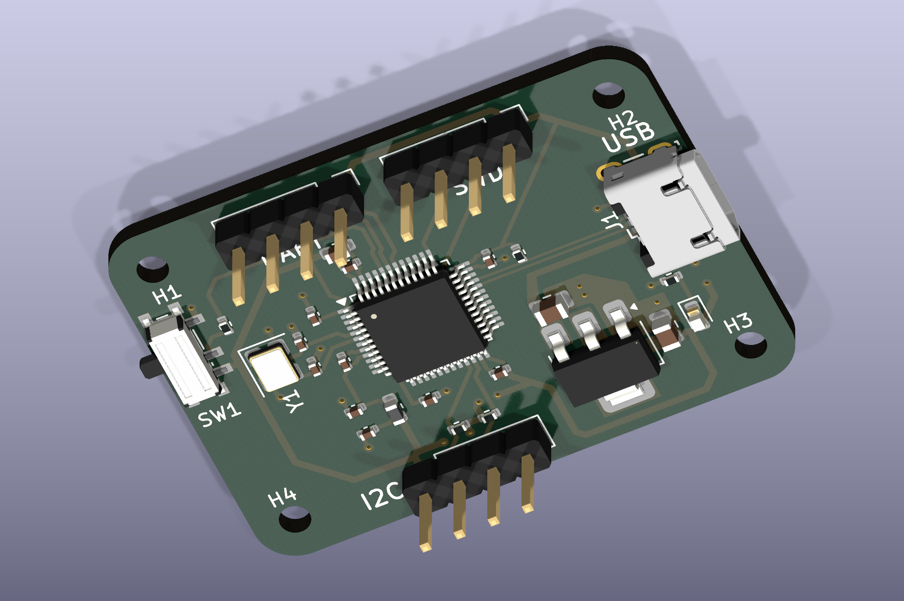

# Microcontroller Projects

Embedded hardware and software projects by **Stavros Stratakis**, covering PCB design, sensor interfaces, serial communication and measurement logging.

## STM32 I²C Development Board

A compact **40 × 28.75 mm, two-layer STM32F103 board** with USB power, 3.3 V regulation, I²C, UART and SWD. Includes editable KiCad sources, schematic PDF, copper-layer views, component mapping, manufacturing exports and verification reports.

**Status:** routed CAD design; ERC and DRC report zero violations with the committed settings. Physical bring-up and firmware validation are pending.

[Explore the design →](STM32-I2C-Development-Board/) · [Schematic](STM32-I2C-Development-Board/docs/schematic/stm32-i2c-board.pdf) · [Verification evidence](STM32-I2C-Development-Board/validation/)

## Arduino Sensor Visualization and Logging

An **Arduino Uno + Processing** application that streams 10-bit potentiometer readings to a desktop visualization, displays a live gauge and records readings to CSV. Includes source code, wiring instructions and an example recording.

**Status:** Arduino sketch compiled for Uno; desktop sketch compiled with Processing 4.4.10; example sensor log included. Live operation requires a local serial-port selection and a connected board.

[Explore the project →](Tweak%20The%20Logo%20Modified/)

## Skills demonstrated

| Area | Evidence |
|---|---|
| Embedded hardware | STM32 support circuitry, decoupling, peripheral connectors and two-layer PCB routing |
| Design verification | Electrical/design-rule reports, schematic-to-PCB parity and source checksums |
| Manufacturing handoff | Gerbers, plated/unplated drills, design BOM and assembly documentation |
| Embedded software | Arduino ADC acquisition and serial transport |
| Instrumentation | Live visualization, structured logging and a staged hardware bring-up plan |

Each project documents its own scope and verification status. CAD renders are labelled as renders; planned hardware tests are distinguished from completed checks.

## Reuse and third-party material

The Arduino software was originally published with an MIT licensing statement; see its [project notes](Tweak%20The%20Logo%20Modified/README.md). The STM32 project records CAD-library and mechanical-model provenance in [third-party asset notes](STM32-I2C-Development-Board/THIRD_PARTY.md).
