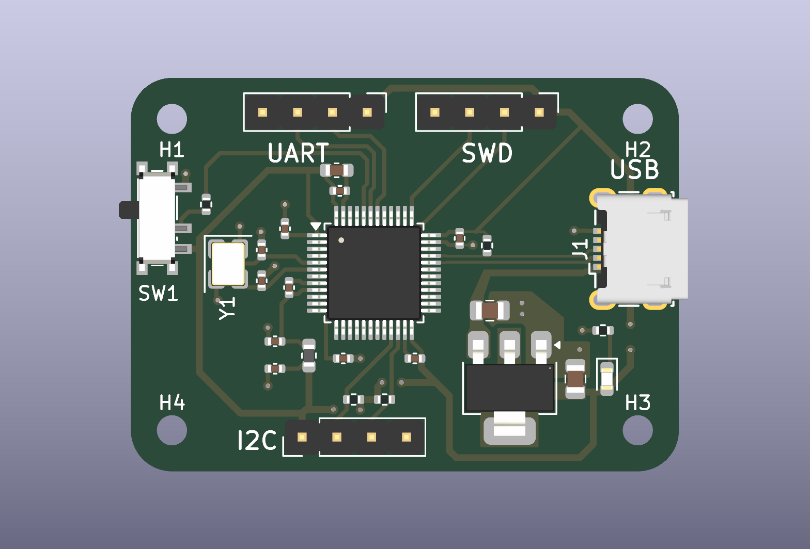

# STM32 I²C Development Board

A compact, two-layer STM32F103C8T6 board for connecting 3.3 V I²C peripherals, developing embedded firmware and accessing the MCU through SWD. USB Micro-B supplies power and connects to the MCU's USB data pins; a separate UART header provides a serial interface.

**Design revision 0.1 · KiCad 9 · 40 × 28.75 mm · 2 copper layers**

[Project brief (5-page PDF)](docs/stm32-i2c-project-brief.pdf) · [Schematic PDF](docs/schematic/stm32-i2c-board.pdf) · [Design notes](docs/design.md) · [Pinout](docs/interfaces.md) · [Verification](validation/README.md) · [Manufacturing outputs](manufacturing/README.md)

For a quick introduction, the **[project brief](docs/stm32-i2c-project-brief.pdf)** explains the board's purpose, operating architecture, support circuitry, PCB layout and verification status, with figures and links to the detailed evidence.

## Design at a glance

| Block | Implementation |
|---|---|
| Microcontroller | STM32F103C8Tx, LQFP-48 |
| Power | USB VBUS → AMS1117-3.3 → 3.3 V; power indicator LED |
| Clock | 16 MHz crystal with two 10 pF load capacitors |
| Sensor interface | I²C2 on PB10/PB11; 1.5 kΩ pull-ups to 3.3 V |
| Debug | Four-pin SWD header: 3.3 V, SWDIO, SWCLK, GND |
| Serial | USART1 on remapped PB6/PB7 |
| USB | D+/D− routed to PA12/PA11; fixed 1.5 kΩ D+ pull-up |
| Construction | 1.6 mm FR-4, two copper layers, four 2.2 mm mounting holes |

## Engineering scope

The project covers schematic capture, component placement, two-layer routing, power decoupling, a filtered analog supply, mechanical integration, design-rule verification and a documented manufacturing handoff. The repository includes editable sources and reviewable exports, so the design can be inspected without installing KiCad.

The hardware design is routed and passes the configured ERC and DRC checks: **0 violations, 0 unconnected items and 0 schematic/PCB parity issues**. [Machine-readable reports and their scope](validation/README.md) are included. Physical assembly, power measurements and peripheral operation remain unverified; there is no STM32 firmware or hardware test log in this revision.

## Review the board

| Component side | Copper routing |
|---|---|
|  |  |

[Bottom copper](docs/images/layout-bottom.svg) · [Assembly drawing](manufacturing/assembly/assembly-top.svg) · [Component map](docs/images/component-map.svg)

The [design notes](docs/design.md) explain the power tree, clock, interface choices and revision-specific constraints. The [bring-up plan](docs/bring-up.md) sets out the measurements needed to take this design from checked CAD to a verified prototype.

## Open and reproduce

1. Install KiCad 9 with its standard symbol, footprint and 3D model libraries.
2. Open [`hardware/stm32-i2c-board.kicad_pro`](hardware/stm32-i2c-board.kicad_pro).
3. The project-local footprint library and USB connector model resolve relative to the project directory.
4. To regenerate checks and exports, run `python scripts/export.py --kicad-cli /path/to/kicad-cli` from this directory. Python uses only its standard library.

The checked outputs were generated with **KiCad 9.0.6**. Later library versions can change footprint-comparison results; use the recorded version for like-for-like verification.

## Repository contents

| Directory | Contents |
|---|---|
| [`hardware/`](hardware/) | KiCad project, schematic, PCB and local library |
| [`docs/`](docs/) | Design rationale, pinout, bring-up plan, schematic and images |
| [`validation/`](validation/) | ERC/DRC reports and source checksums |
| [`manufacturing/`](manufacturing/) | Gerbers, drills, BOM, placement and assembly drawing |
| [`scripts/`](scripts/) | Reproducible checking and export workflow |

See [third-party asset notes](THIRD_PARTY.md) for library and model provenance.
