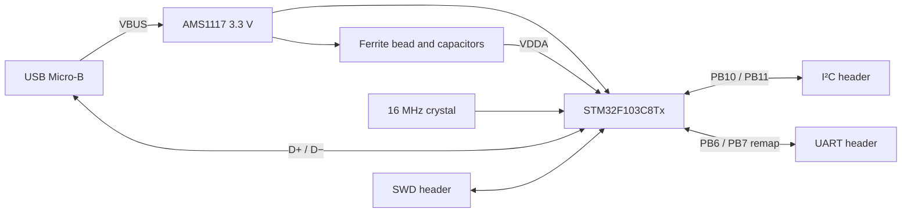

# Hardware design notes

## Purpose and architecture

This board places an STM32F103C8Tx and its support circuitry on a compact two-layer PCB. The MCU hosts a 3.3 V I²C sensor interface, with SWD for development and a separate UART for application diagnostics. The design uses USB Micro-B for its 5 V input and routes the USB data pair to the MCU.

## Power and decoupling

U2 is an AMS1117-3.3 in SOT-223. C12 and C13 are nominally 22 µF at its input and output. C1–C4 provide 100 nF local decoupling, and C5 adds 10 µF bulk capacitance. The 3.3 V rail also supplies the three headers, the D+ pull-up and the power LED through its 1.5 kΩ series resistor.

FB1 separates the analog supply from the digital rail. C6 (10 nF) and C7 (1 µF) bypass +3.3VA, while C8 (1 µF) is on the digital side of the bead. The value `120R` is a ferrite impedance designation; its reference frequency, DC resistance and current rating must be defined by the selected part.

Regulator dissipation follows approximately `(VBUS − 3.3 V) × Iload`, excluding quiescent current. At 5 V and 100 mA total load this is 0.17 W. That calculation is a review point, not a measured current rating. The board's allowable load requires a selected regulator, thermal assessment and bench measurements.

The schematic specifies capacitor values and footprints rather than a fully sourced BOM. The output capacitor's effective capacitance and ESR must match the **exact regulator manufacturer's stability requirements**. An arbitrary AMS1117-labelled part and arbitrary 22 µF MLCC are not an approved combination.

## Clock and reset

Y1 is a 16 MHz crystal with C10/C11 = 10 pF. For equal capacitors, the first-order effective load is `Cload ≈ 5 pF + Cstray`. Select the crystal by load capacitance and ESR, then check oscillator startup; frequency alone is not enough to select a replacement.

C9 is a 100 nF capacitor on NRST. Reset is not brought to the external debug header. SW1 selects the BOOT0 level through R1. Normal operation uses BOOT0 low and programming uses SWD.

## Interface decisions

- **I²C:** PB10/PB11 are routed to J4 with 1.5 kΩ pull-ups. The approximate low-level sink current per asserted line is 3.3 V / 1.5 kΩ = 2.2 mA before accounting for VOL. Check each peripheral's sink capability and measure rise time with the actual cable and combined pull-ups.
- **UART:** J3 uses PB6/PB7, which requires USART1 remapping in firmware. This needs explicit configuration and is recorded in the pinout.
- **USB:** PA11/PA12 connect directly to J1, with a fixed D+ pull-up. This revision has no USB ESD array, no switchable disconnect circuit and no verified impedance-control specification. Functional USB testing and any compliance assessment are separate from DRC.
- **Debug:** the compact four-pin SWD connector carries target reference, SWDIO, SWCLK and GND. Its pinout is project-specific.

## PCB and mechanical implementation

The nominal outline is 40 × 28.75 mm with rounded corners, 1.6 mm board thickness and two 35 µm copper layers in the saved stackup. Four 2.2 mm unplated holes support M2 mounting. Header pitch is 2.54 mm. The MCU uses a 0.5 mm-pitch LQFP-48 package; the smallest passives are 0402.

The MCU occupies the center of the board. The crystal is next to its oscillator pins, USB and the regulator are on the right edge, and the three external headers are at the top and bottom edges. Ground copper and stitching vias support return paths. [Copper-layer exports](images/layout-top.svg) allow the routing and plane continuity to be inspected.

Component reference labels too small for silkscreen were moved to the fabrication layer and enlarged. The assembly drawing and component map preserve component identification; connector names remain on the board. One duplicate 3.3 V via was removed, and two USB footprint outline segments crossing the board edge were moved to the fabrication layer. The USB and switch footprint variants are stored in a project-local library so library comparison is reproducible.

## Revision boundary

Revision 0.1 is a documented **CAD design**, with rule-check and connectivity evidence. It does not yet establish assembled-board performance. Before ordering/assembly: complete manufacturer part selection, validate regulator/capacitor compatibility and crystal loading, review the connector footprints against the chosen parts, and review the exported manufacturing files against the chosen fabricator's rules. Before claiming working hardware: execute the [bring-up plan](bring-up.md).

## Technical references

- STMicroelectronics, [STM32F103x8/xB datasheet](https://www.st.com/resource/en/datasheet/stm32f103c8.pdf): pin functions and electrical requirements.
- STMicroelectronics, [RM0008 reference manual](https://www.st.com/resource/en/reference_manual/cd00171190-stm32f101xx-stm32f102xx-stm32f103xx-stm32f105xx-and-stm32f107xx-advanced-armbased-32bit-mcus-stmicroelectronics.pdf): peripheral remapping and clock configuration.
- KiCad, [PCB Editor documentation](https://docs.kicad.org/9.0/en/pcbnew/pcbnew.html): design-rule checks and fabrication exports.
